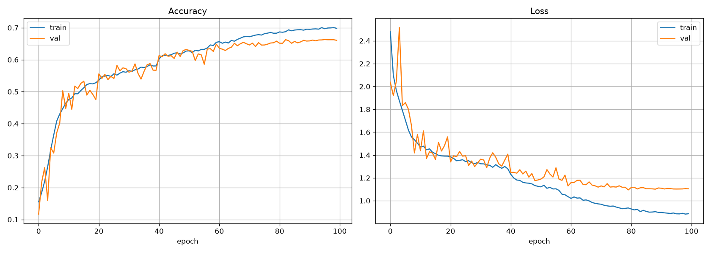
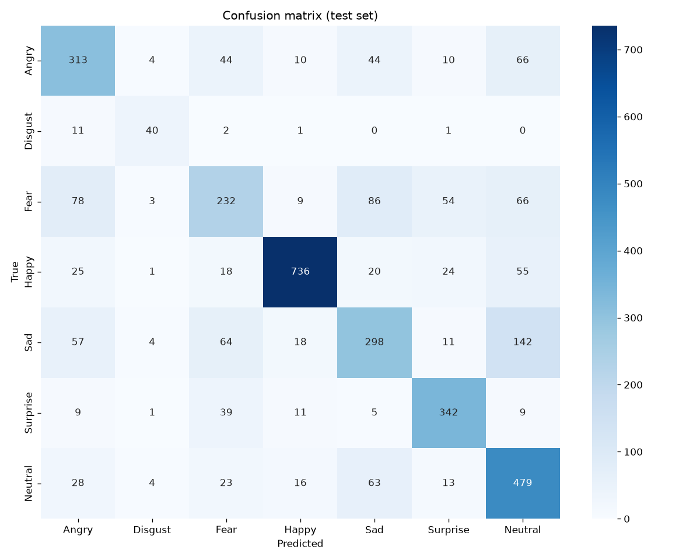

# Facial Expression Recognition Using OpenCV

Detects faces in a webcam feed, video or image and classifies the expression on each one into
7 emotions: **Angry, Disgust, Fear, Happy, Sad, Surprise, Neutral**.

It works in two stages:

1. **Face detection** with OpenCV's Haar cascade (`haarcascade_frontalface_default.xml`, ships with opencv-python so nothing extra to download)
2. **Emotion classification** with a CNN I trained from scratch on the FER2013 dataset

## Project structure

```
model/cnn.py           CNN architecture
utils/data_utils.py    dataset loading, augmentation, face preprocessing
train.py               trains the model and saves results to output/
detect.py              runs detection on webcam / video / image
requirements.txt
```

## Setup

```bash
pip install -r requirements.txt
```

Download `fer2013.csv` from [Kaggle](https://www.kaggle.com/datasets/deadskull7/fer2013) and put it in a `data/` folder.
The file is about 300 MB so it isn't included in this repo.

## Training

```bash
python train.py --csv data/fer2013.csv
```

Optional arguments: `--epochs` (default 100), `--batch` (default 64), `--lr` (default 0.001).
Training stops early if validation loss doesn't improve for 20 epochs. My run used all 100 epochs and took
about 3 hours on CPU (around 110 s per epoch), a GPU will be a lot faster.

After training, `output/` contains:

- `emotion_cnn.h5` - best model (lowest validation loss)
- `training_curves.png` - accuracy and loss per epoch
- `confusion_matrix.png` - per-class results on the test set
- `training_log.csv`

## Running the detector

```bash
python detect.py                      # webcam
python detect.py --source video.mp4   # video file
python detect.py --image photo.jpg    # single image, result is saved as result_<name>
```

Press `q` to quit and `s` to save a screenshot.

## How it works

**Dataset.** FER2013 has 35,887 grayscale face images of 48x48 pixels. I used the official split
(28,709 train / 3,589 validation / 3,589 test). The classes are very unbalanced (Disgust has only ~400
training images while Happy has ~7,000), so the loss is weighted by class.

**Model.** A VGG-style network with about 2.5M parameters:

| Layer | Details |
|---|---|
| Conv block 1 | 2 x Conv 3x3, 32 filters, BatchNorm, ReLU, MaxPool, Dropout 0.25 |
| Conv block 2 | same with 64 filters |
| Conv block 3 | same with 128 filters |
| Conv block 4 | same with 256 filters |
| Dense | 512 then 256 units, BatchNorm, Dropout 0.5 |
| Output | 7 units, softmax |

L2 regularization is used on all conv layers. Training images are augmented with horizontal flips, small
rotations (up to 10 degrees), shifts and zoom. Adam optimizer with the learning rate halved whenever validation loss stops improving.

**Detection.** Each frame is converted to grayscale and histogram-equalized for the Haar cascade. Every
detected face is cropped with a small margin, resized to 48x48 and passed to the CNN. When there is only
one face in the frame, predictions are averaged over the last 5 frames so the label doesn't jump around.

## Results

**68.0% accuracy on the FER2013 test set** (PrivateTest, 3,589 images). For reference, human accuracy on
this dataset is around 65% because a lot of the labels are noisy or ambiguous.

| Emotion | Precision | Recall | Test images |
|---|---|---|---|
| Angry | 0.60 | 0.64 | 491 |
| Disgust | 0.70 | 0.73 | 55 |
| Fear | 0.55 | 0.44 | 528 |
| Happy | 0.92 | 0.84 | 879 |
| Sad | 0.58 | 0.50 | 594 |
| Surprise | 0.75 | 0.82 | 416 |
| Neutral | 0.59 | 0.77 | 626 |



Validation accuracy levels off at about 66% after epoch 80, once the learning rate has been halved a few times.
Training accuracy ends only slightly higher (~70%), so the dropout and augmentation keep overfitting under control.



- Happy and Surprise are the easiest classes.
- Fear is the hardest one, it gets mixed up with Sad, Angry and Neutral.
- The most common single mistake is Sad predicted as Neutral.
- Disgust does reasonably well (73% recall) even though it has so few images, which is mostly thanks to the class weights.

## Limitations

- Haar cascades only find fairly frontal faces, so faces turned to the side or partly covered are often missed.
- The model only sees a 48x48 grayscale crop, so subtle expressions are hard to tell apart.
